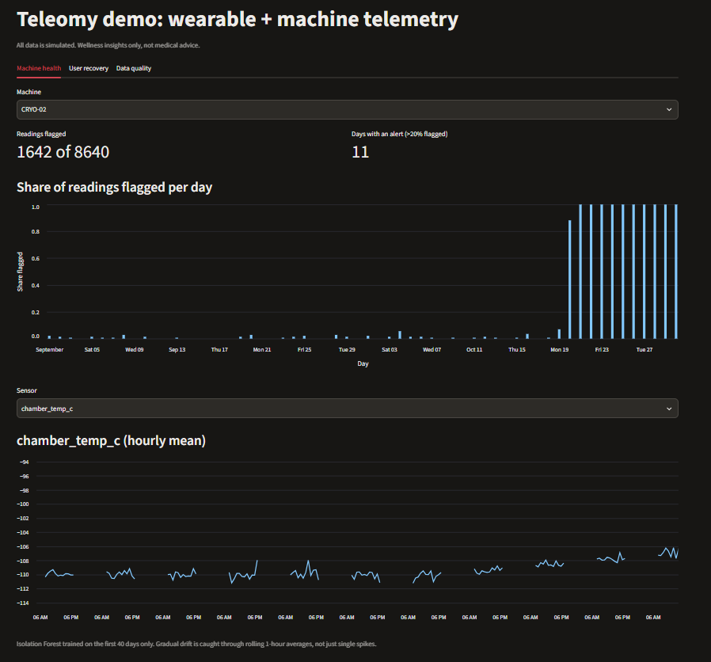
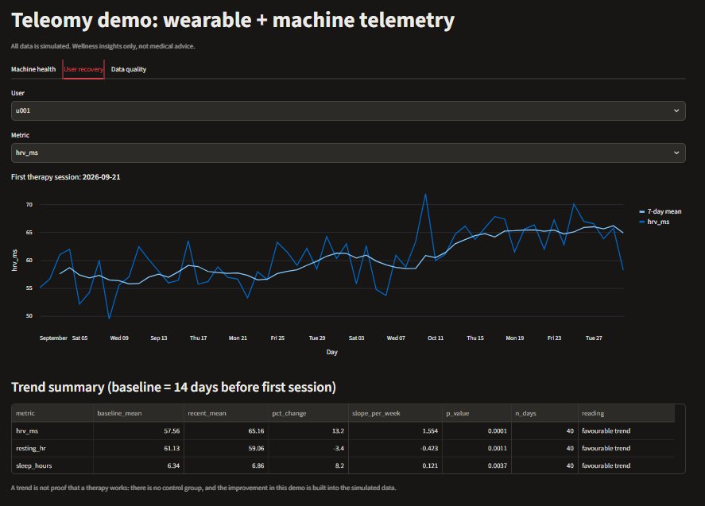
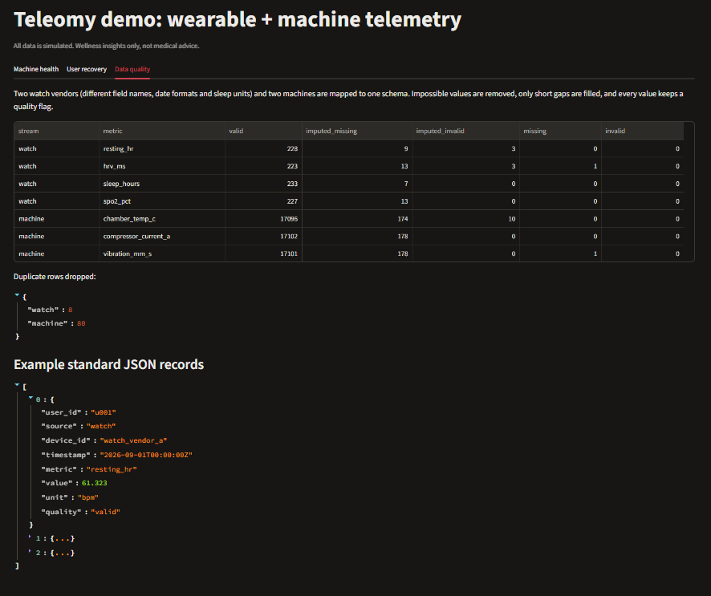

# Teleomy demo: wearable + machine telemetry

A small prototype of a health-telemetry backend. Raw data from smartwatches and
IoT machines goes in, one clean standard JSON feed comes out, and two ML models
turn it into insights shown in a Streamlit dashboard.

> **All data is simulated.** The improvement in the watch data after "therapy" is
> built into the simulator so the trend model has something to find. It is not
> evidence that any therapy works. Outputs are wellness insights, not medical advice.



## What it does

```
watch vendor A ─┐
watch vendor B ─┼─> unify -> validate -> clean -> JSON feed ─┬─> Isolation Forest -> machine alerts
machine logs  ──┘   (schemas, units)     (flags)              └─> recovery trends  -> user insights
                                                                         |
                                                                  Streamlit dashboard
```

1. **Simulation** (`simulate.py`, `simulate_watch.py`): 2 cryo machines sampled every
   5 minutes for 60 days (one slowly degrades in its last 12 days), and 4 users with
   daily watch summaries from two vendors that use different field names, date formats
   and sleep units. Injected problems: missing values, impossible values, duplicates.
2. **Cleaning** (`clean.py`): maps everything to one schema, drops duplicates, blanks
   impossible values, fills only short gaps (up to 2 points), and keeps a quality flag
   on every value: `valid`, `imputed_missing`, `imputed_invalid`, `missing`, `invalid`.
   One output record:
   ```json
   {"user_id": "u001", "source": "watch", "device_id": "watch_vendor_a",
    "timestamp": "2026-09-01T00:00:00Z", "metric": "resting_hr", "value": 61.323,
    "unit": "bpm", "quality": "valid"}
   ```
3. **Machine anomaly detection** (`models.py`): Isolation Forest on three sensors plus
   1-hour rolling means, so slow drift shows up and not only spikes. Trained on the
   first 40 healthy days only. A day raises an alert when more than 20% of its
   readings are flagged.
4. **Recovery trends** (`models.py`): for each user, compares a personal baseline (14
   days before the first session) with the last 14 days, and fits a linear trend with
   a p-value for HRV, resting heart rate and sleep.
5. **Dashboard** (`app.py`): machine health, user recovery and data quality tabs.

## Results (seeded, reproducible)

| Check | Result |
|---|---|
| Duplicate rows dropped | 8 watch, 80 machine |
| Impossible values caught | 6 watch, 10 machine (all flagged `imputed_invalid`) |
| First alert on the degrading machine | 2026-10-20 (drift starts 2026-10-19) |
| Alerts on the healthy machine | none |
| Recall on labelled fault readings | 0.998 |
| Precision on labelled fault readings | 0.754 |
| Users with a favourable trend (HRV, resting HR, sleep) | 12 of 12 user-metric pairs, p < 0.005 |

On precision: the ground-truth label marks drift as faulty only once it exceeds 30% of
its final size, but the detector starts flagging in the first days of drift. Most of
the "false positives" are those early readings, so the figure understates the detector.
A real deployment would need real failure records to measure this properly.
The 12-of-12 trend result reflects an effect built into the simulator.




## Run it

```
git clone https://github.com/Danish-2003/teleomy-demo.git
cd teleomy-demo
uv sync
uv run streamlit run app.py
```

The simulated data is generated automatically on first launch. Individual steps:

```
uv run python -m teleomy.clean     # build data/telemetry.jsonl
uv run python -m teleomy.models    # train, score, print metrics
```

## Project layout

```
app.py                  Streamlit dashboard
src/teleomy/
  simulate.py           machine sensor simulator
  simulate_watch.py     watch + session simulator (two vendor formats)
  clean.py              unify, validate, clean, quality flags, JSON feed
  models.py             Isolation Forest, recovery trends
  data.py               generates the data on first run
```

## Limitations

- Simulated data. Real wearable data is noisier and more varied.
- No control group, so a favourable trend does not show that therapy caused it. P-values
  are optimistic because consecutive days are correlated.
- Isolation Forest says a reading is unusual, not what failed or why.
- No consent handling, anonymisation or access control. A real health product must
  handle these (for example under India's DPDP Act) before touching user data.

## Next steps

- Replace the simulator with a real public wearable dataset and the real machine feed.
- Compare against an LSTM autoencoder detector.
- Evaluate the detector against real failure records.
- Join sessions to machine health to see whether recovery depends on machine condition.